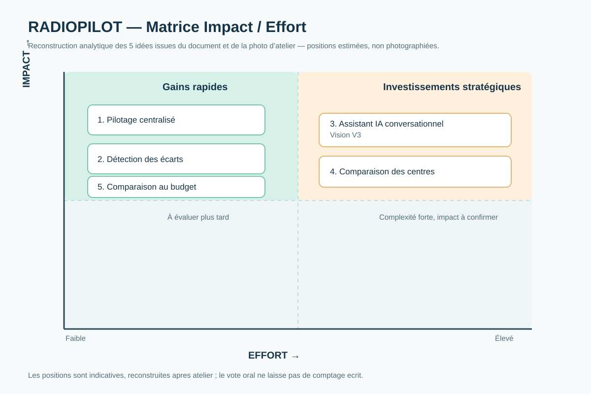

# 02 — Idéer et converger

**Projet : RADIOPILOT**  
**Équipe : Habib KOFFI et Hariph ASSOUMA ALASSANE**

## 1. Divergence — Crazy 8

L'équipe a fourni le **10 novembre 2026 une photographie originale montrant deux feuilles disposées chacune en huit cases**. La première comporte huit croquis ; la seconde présente huit pistes sous forme principalement textuelle. L'attribution de chacune des feuilles à un membre n'est pas établie sur la photo.

### Feuille supérieure — huit idées et croquis identifiables

| Case | Intitulé reformulé en trois mots maximum | Indice présent sur le croquis |
|---|---|---|
| 1 | Vue consolidée | Tableau de bord avec graphiques |
| 2 | Alertes écarts | Deux notifications d'alerte |
| 3 | Analyse des causes | Arbre de facteurs (vacations, examens, autres) |
| 4 | Comparaison budgétaire | Barres réalisé / budget |
| 5 | Performance des centres | Classement Centre A, B et C |
| 6 | Utilisation équipements | Jauge circulaire d'utilisation |
| 7 | Simulation d'actions | Réglages et courbe projetée |
| 8 | Suivi temps réel | Écran avec courbes d'évolution |

### Feuille inférieure — huit propositions textuelles

| Case | Libellé lisible ou interprétation prudente |
|---|---|
| 1 | N / N-1 (comparaison temporelle) |
| 2 | Activité reliée aux vacations |
| 3 | KPI consolidés |
| 4 | Suivi historique de FT (abréviation relevée, à confirmer) |
| 5 | Assistant questions (IA) |
| 6 | Rapport automatique mensuel |
| 7 | Alertes écarts |
| 8 | Analyse des causes |

**Fidélité de la preuve :** la photo atteste deux supports de huit cases. Elle ne permet pas de prouver indépendamment les huit minutes d'exécution, l'identité de chaque auteur ni un croquis dans chaque case de la seconde feuille. Les libellés ci-dessus servent à **transcrire** les idées, sans remplacer les inscriptions manuscrites.

**Pièce photographique à déposer :** `docs/img/crazy8-groupe.jpg` (original transmis dans la conversation ; mise en ligne à réaliser).

## 2. Convergence — vote

Le groupe confirme avoir **voté oralement** et retenu trois axes :
1. Pilotage centralisé intelligent ;
2. Détection des écarts et aide à la décision ;
3. Assistant IA conversationnel.

Le PDF du professeur prescrit **un vote par points en silence, trois points par personne**. Aucun décompte chiffré n'a été conservé. En conséquence, **la sélection orale est authentiquement déclarée mais ne doit pas être présentée comme la preuve d'un vote silencieux à points** ; aucun score n'est inventé.

## 3. Matrice Impact / Effort — cinq idées

Conformément à la demande de placer **cinq idées**, la matrice utilise les **trois axes de convergence rapportés par le groupe**, puis deux idées complémentaires directement observables dans les Crazy 8 :

| Idée | Impact potentiel | Effort relatif estimé | Justification | Périmètre |
|---|---|---|---|---|
| Pilotage centralisé intelligent | Élevé | Modéré | Vision commune des KPI | MVP |
| Détection des écarts | Élevé | Modéré | Repérage des anomalies budgétaires | MVP |
| Assistant IA conversationnel | Élevé | Élevé | Questions en langage naturel, nécessité de garanties sur l'explicabilité | V3 |
| Comparaison des centres | Élevé | Élevé | Comparabilité dépendant des équipements et des périmètres | MVP contextualisé |
| Comparaison réalisé/budget | Élevé | Faible à modéré | Calcul simple si les sources et définitions concordent | MVP |

**Statut méthodologique :** ce schéma est une **reconstruction structurée** à partir de la photo et du document déjà rédigé ; il ne prétend pas être la photographie d'une matrice physique originale ou le classement chiffré d'un vote.

La présence de l'**assistant IA conversationnel** parmi les idées retenues est préservée. La décision cohérente avec la charte et la proposition de valeur consiste à le préparer pour **V3**, non à le retirer du concept. Son utilité devra être démontrée avant tout développement avancé.

## 4. Concept retenu — confirmé par le groupe

**RADIOPILOT** est le concept retenu.

**Phrase-concept (format demandé) :**  
> RADIOPILOT propose une plateforme de pilotage centralisé des indicateurs financiers et opérationnels aux directeurs administratifs et financiers et aux directeurs des opérations des centres d'imagerie médicale, pour comparer les performances, détecter les écarts significatifs et faciliter les décisions, contrairement aux pratiques de rapprochement manuel de sources distinctes.

## Traçabilité

- **Photo :** originale, fournie par le groupe le 10 novembre 2026. Les deux feuilles montrent 16 propositions.
- **Vote :** oral, confirmé par le groupe, sans répartition chiffrée documentée.
- **Matrice :** reconstruite par l'IA à partir des idées visibles et de la convergence déclarée ; les positions Impact/Effort sont des estimations, **pas des mesures**.
- **Choix final :** RADIOPILOT, confirmé explicitement par le groupe.

Aucun entretien utilisateur ni résultat quantitatif supplémentaire n'est revendiqué.
