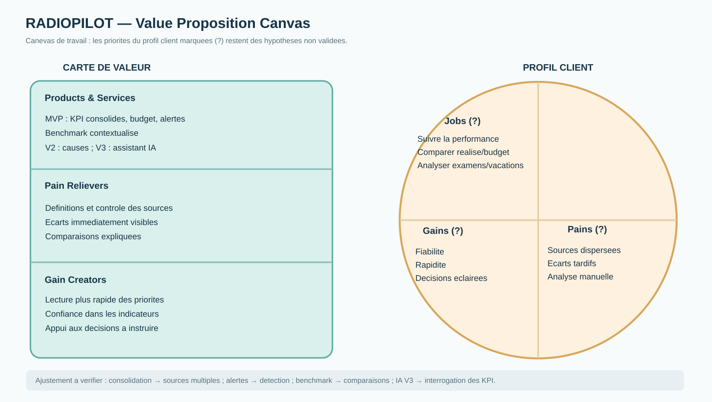

# 03 — Proposition de valeur (RADIOPILOT)

> Les classements sont des hypothèses de conception, **pas des priorités confirmées par entretien**. Les « ? » marquent explicitement les éléments à vérifier.

## Profil client — Persona 1 : DAF

| Priorité proposée | Jobs (tâches) ? | Pains (frustrations) ? | Gains (bénéfices attendus) ? |
|---|---|---|---|
| 1 | Suivre la performance financière | Rapprocher plusieurs sources | Indicateurs fiables et consolidés |
| 2 | Comparer réalisé / budget | Risque de chiffres incohérents | Identifier rapidement les écarts |
| 3 | Expliquer les écarts à la direction | Écarts identifiés tardivement | Réduire la préparation des reportings |
| 4 | Préparer reportings et prévisions | Analyses manuelles répétitives | Décider avec une vision cohérente |

## Profil client — Persona 2 : directeur des opérations

| Priorité proposée | Jobs (tâches) ? | Pains (frustrations) ? | Gains (bénéfices attendus) ? |
|---|---|---|---|
| 1 | Suivre l'activité des centres | Indicateurs dispersés | Repérer rapidement une variation |
| 2 | Repérer les centres à risque | Difficulté d'explication d'une baisse | Comparer les centres |
| 3 | Analyser examens, vacations, équipements | Détection tardive | Comprendre les facteurs associés |
| 4 | Prioriser les actions | Comparaisons manuelles | Prioriser les actions opérationnelles |

**« ? » = hypothèse non validée** pour chaque attente ou difficulté inférée. Les postes métiers des personas constituent le cadrage, et non la preuve de ces besoins.

## Carte de valeur

**Produits et services**
- **MVP / V1 :** vue consolidée, comparaison réalisé/budget, benchmark sous conditions de comparabilité, alertes sur écarts, métadonnées de transparence.
- **V2 :** exploration des facteurs possibles des écarts, utilisation détaillée des équipements.
- **V3 :** simulation d'actions, temps réel, **assistant IA conversationnel** (sans décision automatique non supervisée).

| Pain reliever | Frustration visée |
|---|---|
| Consolidation et contrôles élémentaires | Sources multiples et chiffres incohérents |
| Signalement des écarts | Détection tardive |
| Comparaison contextualisée | Comparaisons manuelles ou trompeuses |
| Exploration des facteurs (V2) | Explication difficile |
| Recherche en langage naturel (V3) | Recherche d'informations longue |

| Gain creator | Bénéfice ciblé |
|---|---|
| Définition commune des KPI | Lecture fiable des résultats |
| Calcul réalisé / budget | Suivi budgétaire |
| Comparaison entre centres, à périmètre comparable | Repérage des priorités |
| Alertes justifiées et traçables | Aide à la décision |
| Assistant IA explicable (V3) | Interrogation plus accessible |

## Vérification de l'ajustement (fit)

| Frustration majeure | Réponse | Niveau de preuve |
|---|---|---|
| Rapprocher plusieurs sources | Vue consolidée et contrôles | Hypothèse — test utilisateur requis |
| Chiffres contradictoires | Définition des KPI, contrôles et fraîcheur | Hypothèse — jeux de référence requis |
| Détection tardive | Écarts et alertes | Hypothèse — mesurer temps et exactitude |
| Comparaisons trompeuses | Benchmark contextualisé | Hypothèse — homogénéité des centres à démontrer |
| Causes des écarts difficiles | Exploration en V2 | Besoin à vérifier ; hors MVP |

Le modèle graphique officiel du Value Proposition Canvas (annexes PSB Learn) doit être complété avec ces éléments et ajouté au rendu si demandé en cours. Ce texte respecte la logique « cercle d'abord, carré ensuite », mais **n'est pas à lui seul une preuve du canevas graphique officiel**.

## Proposition de valeur

RADIOPILOT aide les DAF et directeurs des opérations à suivre les performances des centres d'imagerie médicale à partir d'indicateurs consolidés, de comparaisons budgétaires et d'alertes interprétables. La centralisation vise à réduire le temps d'identification des écarts, sans présumer de l'efficacité avant test.

## Support visuel de conception

**Attention :** cette visualisation facilite la relecture ; **le canevas officiel des annexes PSB Learn reste à compléter** avant la remise. Les hypothèses du profil client ne sont pas des constats d'entretien.
