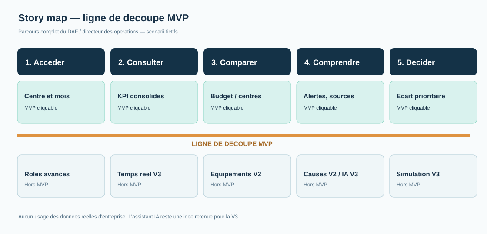

# 05 — MVP : apprendre avant de développer

> **Décision de cadrage cohérente avec les autres livrables :** prototype **cliquable**, alimenté par des **scénarios fictifs vérifiés**, sans intégration VIDI réelle ni assistant IA opérationnel. L'assistant IA conversationnel reste au programme **V3**.

## 1. Hypothèse la plus risquée

**H1 — hypothèse réfutable.**
« Nous pensons que le DAF et le directeur des opérations utiliseront une vue consolidée de la performance pour identifier les écarts prioritaires, parce que la centralisation des KPI financiers et opérationnels simplifiera leur analyse. Nous le saurons si le temps moyen nécessaire pour identifier trois écarts prédéfinis diminue d'au moins **30 %** par rapport à la méthode actuelle, **sans perte d'exactitude**. »

**Pourquoi risquée ?** Une vue unique pourrait au contraire ajouter de la complexité. Le gain d'efficacité n'est pas démontré.

**Autres suppositions à classer par risque avant test :** accès à des données comparables ; définitions harmonisées ; utilité des alertes ; compréhension des KPI ; besoin d'un assistant conversationnel. **Le choix H1 reste une proposition de cadrage**, en l'absence de preuve issue des utilisateurs.

## 2. Forme la plus légère du MVP

Un **prototype cliquable**, présentant (1) une vue consolidée, (2) réalisé/budget, (3) un benchmark contextualisé, (4) des alertes visibles et explicables, (5) le détail de définition/source/fraîcheur d'un KPI (responsabilité). Les nombres des cas tests sont **entièrement fictifs**. La maquette simule les changements de centre/période, et non des calculs live ou une connexion au SI.

**Hors MVP :** analyse approfondie des facteurs (V2), détail des équipements (V2), simulation, actualisation temps réel et assistant IA conversationnel (V3).

### Protocole prévisionnel

Créer deux scénarios de complexité comparable comportant chacun trois écarts. Chaque testeur effectue l'identification (a) avec un support de référence de reporting, (b) avec le prototype. Alterner l'ordre de passage selon les testeurs pour limiter l'apprentissage ; consigner le temps, les écarts correctement trouvés et les remarques. Le gain se calcule : **(temps référence − temps MVP) / temps référence × 100**. Le seuil de 30 % est **proposé**. Ne pas confondre satisfaction déclarée et performance mesurée. **Aucun utilisateur n'a encore été déclaré testé dans les sources fournies.**

## 3. Story map — parcours complet

| Parcours | 1. Accéder | 2. Consulter | 3. Comparer | 4. Comprendre | 5. Décider |
|---|---|---|---|---|---|
| **MVP — au-dessus de la ligne** | Choisir centre/période | Vue KPI consolidés et sources | Budget et benchmark contextualisé | Alerte + définition explicable | Sélectionner l'écart prioritaire |
| **— LIGNE DE DÉCOUPE MVP —** | — | — | — | — | — |
| Versions ultérieures | Gestion avancée des rôles | Temps réel (V3) | Équipements (V2) | Facteurs (V2) ; assistant IA (V3) | Simulations d'actions (V3) |

Le MVP couvre toutes les étapes du parcours sans prétendre construire toute la solution. Les interactions sont simulées sur données fictives.

## 4. User stories et critères d'acceptation

### US01 — Vue consolidée
**En tant que DAF**, je veux consulter sur une même vue les indicateurs d'un centre afin de suivre sa performance sans multiplier les reportings.

- **Given** un scénario de centre et mois dont les données fictives sont définies, **When** je sélectionne centre et mois, **Then** la maquette affiche les valeurs correspondantes de CA, honoraires, examens et vacations.
- **Given** un autre mois du jeu de scénarios, **When** je le sélectionne, **Then** l'ensemble des KPI du scénario change de façon cohérente.

**Données :** centre, période, CA, honoraires, examens, vacations ; voir [04-crisp-dm.md](04-crisp-dm.md).

### US02 — Réalisé / budget
**En tant que DAF**, je veux comparer le CA réalisé au budget afin d'identifier les écarts.

- **Given** un cas fictif avec réalisé et budget non nul, **When** je consulte l'écart, **Then** le montant, le pourcentage et la convention de signe correspondent aux valeurs attendues.
- **Given** un budget nul ou absent dans un cas fictif, **When** j'affiche l'écart, **Then** le pourcentage indique « non calculable », sans division par zéro.

**Données :** réalisé, budget, centre, période, statut du budget.

### US03 — Benchmark des centres
**En tant que directeur des opérations**, je veux comparer les centres afin de repérer ceux qui exigent une attention particulière.

- **Given** plusieurs centres et une même période fictifs, **When** je choisis un indicateur, **Then** je vois les valeurs de la même période.
- **Given** deux centres d'activités différentes, **When** je les compare, **Then** la maquette signale les différences pertinentes et évite de présenter leur classement comme une conclusion causale.

**Données :** centre, période, indicateurs, activités et équipements de contexte.

### US04 — Alertes
**En tant que directeur des opérations**, je veux voir les écarts significatifs afin de prioriser les investigations.

- **Given** un seuil fictif clairement indiqué, **When** un écart le dépasse, **Then** une alerte présente centre, période, indicateur et valeur de l'écart.
- **Given** une donnée nécessaire manquante, **When** le cas est affiché, **Then** l'état est « alerte non évaluable » plutôt que « aucune alerte ».

**Données :** réalisés, objectifs, seuils fictifs, qualité.

### US05 — Transparence et protection
**En tant qu'utilisateur**, je veux voir la définition, la source et la fraîcheur de chaque indicateur afin de savoir ce que signifie le chiffre présenté.

- **Given** un KPI de la maquette, **When** je consulte son détail, **Then** sa définition, sa source **fictive** et sa date de référence sont indiquées.
- **Given** une personnalisation facultative dans un scénario de conception, **When** je la refuse, **Then** le parcours métier essentiel demeure accessible sans cette personnalisation.

**Données :** dictionnaire KPI, provenance fictive, date, préférences éventuelles. La deuxième condition est une exigence de conception responsable **hypothétique** si la personnalisation n'est pas développée dans la maquette.

## 5. Règle de validation

Les critères de test sont vérifiables sur prototype interactif ; ils n'attestent **pas** du fonctionnement d'un système de données réel. Aucun seuil métier autre que le **30 % du test** n'est présenté comme validé par un utilisateur.

## Visualisation et protocole associé

- [Protocole d'évaluation prévu](protocole-test.md)
- [Jeu de données et calculs de référence](data-dictionary.md)

Cette story map reste une transcription visuelle du **même périmètre MVP / V2 / V3** que la charte, la proposition de valeur et le deck ; elle n'atteste pas qu'une séance d'observation ou un test utilisateur a eu lieu.
